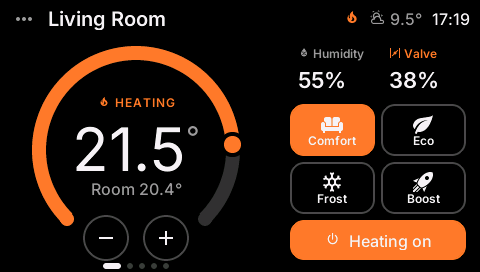
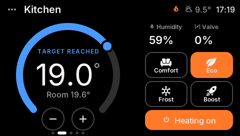
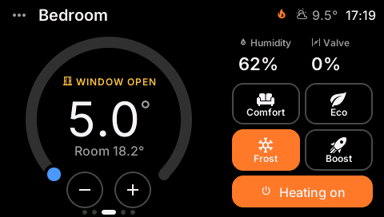
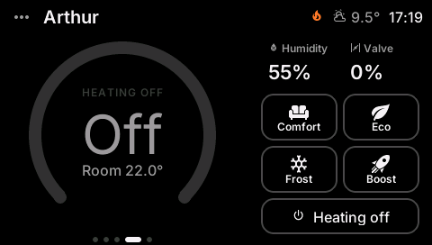
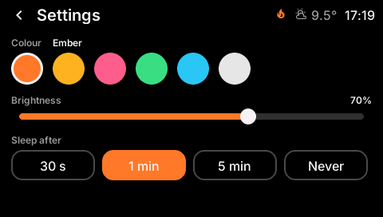
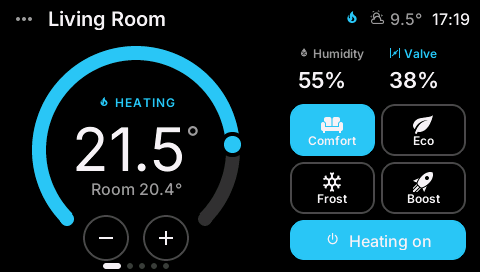

# ESP32-S3 Thermostat Panel

[](https://github.com/Boisti13/esp32-s3-thermostat/releases)
[](LICENSE)


A wall thermostat for Home Assistant on a cheap 4.3" ESP32-S3 touch display.
Every room's heating on one screen: swipe between rooms, drag the dial to set
the temperature, tap a preset. Built with ESPHome and LVGL; made for
[Versatile Thermostat](https://github.com/jmcollin78/versatile_thermostat),
but works with any Home Assistant `climate` entity that heats.



## Highlights

- **One tile per room**: swipe left for the next room, right for the
  previous; the room switches in one go (no drag animation, which an SPI
  panel can't draw smoothly), and a swipe never presses the button it
  started on. Dots at the bottom show where you are.
- **Made for this panel**: black background, outlined buttons, solid orange
  for what's active. The panel brightens and tints dark colours, and in
  16-bit colour dim filled shapes get stair-stepped edges; bright edges on
  black stay smooth. The home room comes first and comes back when the screen wakes.
- **Big dial**: drag the knob or tap the ring, or use − / + (hold to repeat),
  in the entity's own steps of 0.5 °C. Sent to Home Assistant when you let
  go, so the dial never fights you.
- **Colour tells the state**: orange while the radiator heats, blue when on
  and idle, grey when off. Status line: *Heating*, *Idle*, *Target reached*,
  *Window open*.
- **Presets** Comfort, Eco, Frost, Boost; the active one is highlighted.
- **Room temperature, humidity and valve opening** for each room.
- **Header**: room name on the left; on the right the clock, outdoor
  temperature, a flame while the main heating supply is on, and warning
  icons when the central mode is *Stopped* or Home Assistant isn't
  connected.
- **Settings page** (⋯ top left): six colour schemes (Ember, Amber, Rose,
  Forest, Ocean, Mono), brightness, and *Sleep after* (30 s, 1 min, 5 min,
  Never). They are kept in flash and are also entities in Home Assistant.
- **Runs on a battery**: dims after 15 s, deep-sleeps after *Sleep after*
  (1 min by default) with the backlight held off. A touch or the BOOT button wakes it, and it shows the
  last known values at once (kept in RTC memory) while it reconnects. A
  *Stay awake* switch in Home Assistant keeps it on for updates or on USB.
- **Battery level** in the status bar and Home Assistant (optional, needs
  two resistors, see [Battery](#battery)).

| Heating | Target reached | Window open | Off |
|---|---|---|---|
|  |  |  |  |

| Settings | Ocean scheme |
|---|---|
|  |  |

## Hardware

| Part | |
|---|---|
| Board | Guition **JC4827W543C** (the *C* = capacitive touch) |
| Chip | ESP32-S3-WROOM-1 N4R8: 4 MB flash, 8 MB octal PSRAM |
| Screen | 4.3" IPS, 480 × 272, NV3041A on quad SPI (CLK 47, D0–D3 21/48/40/39, CS 45); keeps its own picture |
| Touch | GT911 capacitive, I²C SDA 8 / SCL 4, INT 3, RST 38 |
| Backlight | GPIO1 (PWM, 1 kHz) |
| Power | USB-C, 5 V, or a single-cell LiPo on the battery plug |

Not to be confused with the Sunton **ESP32-4827S043** (same size, TN panel
on a 16-bit RGB bus, other pins); this firmware doesn't run on that one.
The resistive JC4827W543**R** needs a different `touchscreen:` block in
`src/main/hardware.yaml`. If the picture is upside down on your unit, set
both `mirror_x`/`mirror_y` under the display's `transform:` to `false`.

## Install

| Step | |
|---|---|
| 1 | Copy `secrets.example.yaml` to `secrets.yaml` and fill in Wi-Fi and a new API key (`openssl rand -base64 32`). In Home Assistant's ESPHome app the shared `secrets.yaml` gets `thermostat_api_key`. |
| 2 | Edit `src/main/entities.yaml`: your rooms (name, climate entity, window contact) and the status bar entities. |
| 3 | Flash once over USB: `esphome run thermostat.yaml`. After that, over Wi-Fi. |
| 4 | Home Assistant finds the device; add it with the API key. |
| 5 | **Allow the device to perform Home Assistant actions** (Settings → Devices → ESPHome → Thermostat Panel → Configure). Without it the panel shows everything but can't change anything. |

### Home Assistant's ESPHome app

Put the project in a folder of its own next to the other configs and point a
small top-level file at it:

```yaml
# /homeassistant/esphome/thermostat-panel.yaml
substitutions:
  project_dir: ./esp32-s3-thermostat
packages:
  panel: !include esp32-s3-thermostat/thermostat.yaml
```

## Battery

The backlight is most of the draw while the screen is on and Wi-Fi the
rest, so there is no useful half-awake state: the panel is either fully
awake (screen on) or in deep sleep (screen off).

| State | What runs | Rough draw |
|---|---|---|
| Awake | CPU, Wi-Fi, panel, backlight at 70 % | 150–250 mA |
| Dimmed (after `idle_dim_s`) | same, backlight 15 % | ~100 mA |
| Deep sleep (after *Sleep after*) | ESP32 off, touch controller on | board-dependent, see below |

- **Wake-up**: a touch (GT911 INT on GPIO3) or the BOOT button. After a wake the screen is up in about a
  second with the last values; live data follows in 2–4 s (Wi-Fi with
  `fast_connect`, then Home Assistant). A static IP (`manual_ip` under
  `wifi:`) saves another second.
- **Sleep current is mostly the board**, not the ESP32 (~10 µA): the 3.3 V
  regulator's own draw, the power LED, the USB-serial chip and the
  charger. Measure it once. If it's several mA, the usual fixes are
  removing the power LED and swapping the regulator for a low-quiescent
  one (e.g. ME6211/HT7333); that is the difference between days and months
  per charge.
- **Stay awake** (switch in Home Assistant): no deep sleep, just a dark
  screen. Turn it on before an OTA update; the device can only be reached
  while awake, so wake it with a touch first. *Sleep after: Never* keeps it
  on (dimmed), for USB power.
- Make it last longer: lower *Brightness*, shorter *Sleep after*.

### Battery level

The board doesn't route the battery voltage to any pin. Two 220 kΩ resistors
from battery + to GND with the middle on a free ADC1 pin of an expansion
header (`battery_adc_pin`, default **GPIO5**; check your board's header
print), plus 100 nF from that pin to GND, then add
`battery: !include src/main/battery.yaml` to the packages in
`thermostat.yaml`. It reads once per wake, before Wi-Fi starts (the radio's
current makes the reading sag), and shows a battery icon
with % in the status bar plus *Battery* and *Battery voltage* in Home
Assistant. The divider draws ~10 µA all the time.

## Rooms and entities

All of it lives in `src/main/entities.yaml`.

| Setting | Example | |
|---|---|---|
| `room_N_name` | `Living Room` | shown on the tile (letters, digits, spaces) |
| `room_N_entity` | `climate.living_room_radiator` | the room's climate entity |
| `room_N_window` | `binary_sensor.balcony_door_contact` | window/door contact; `binary_sensor.none` = none |
| `outdoor_temperature_entity` | `sensor.virtual_outdoor_temperature` | status bar |
| `main_valve_entity` | `switch.heat_exchanger` | flame in the status bar while on; `switch.none` = never |
| `central_mode_entity` | `select.central_mode` | warning while *Stopped* |
| `idle_dim_s`, `dim_brightness_f` | `15`, `0.15` | dim after 15 s to 15 % |
| `default_brightness`, `default_sleep`, `default_scheme` | `70`, `1 min`, `Ember` | first-boot values of the settings |

The settings themselves are entities: *Colour scheme* and *Sleep after*
(select), *Brightness* (number), next to *Stay awake* and *Backlight*.

From each climate entity the panel reads its state (`heat`/`off`) and the
attributes `temperature`, `current_temperature`, `current_humidity`,
`hvac_action`, `preset_mode`, `min_temp`, `max_temp` and (Versatile
Thermostat) `valve_open_percent`. It calls `climate.set_temperature`,
`climate.set_preset_mode` and `climate.set_hvac_mode` (`heat`/`off`).

## Example: a cold morning

The living room is at 20.4 °C, Comfort is 21.5 °C. The tile shows the dial
in orange with *Heating*, valve 38 %, and the flame in the status bar
because the main supply is open. Swipe once to the kitchen: blue dial,
*Target reached*, Eco highlighted. Swipe to the bedroom: the window is open,
so the status line turns yellow and Versatile Thermostat has dropped the
target to frost. Tap **+** twice on the kitchen tile: the dial shows 20.0,
and a second later Home Assistant gets `climate.set_temperature` with 20.0
(Versatile Thermostat switches the preset to manual).

## Layout

```
thermostat.yaml            device: Wi-Fi, API, OTA, packages
src/main/hardware.yaml     board: PSRAM, QSPI panel, GT911 touch, backlight
src/main/entities.yaml     your rooms and entities
src/main/theme.yaml        colours, fonts, icons
src/main/ui.yaml           LVGL: theme, tileview, screen saver
src/main/status.yaml       status bar logic (clock, outdoor, central mode)
src/main/status_widgets.yaml   status bar and page dots
src/main/settings.yaml     settings entities, colour schemes, dim/sleep timing
src/main/settings_page.yaml    the settings page
src/main/schemes.h         the colour schemes
src/main/power.yaml        deep sleep, wake pins, RTC value cache, Stay awake
src/main/rtc_cache.h       the cache's layout
src/main/battery.yaml      optional battery level (needs the mod)
src/room/room.yaml         one room: HA values, refresh, actions (×5)
src/room/tile.yaml         one room's tile (×5)
demo/screenshot.yaml       the UI on a PC (SDL) with made-up values
scripts/screenshots.sh     renders docs/images/*.png
```

## Development

- ESPHome **2026.9.1** (`requirements.txt`), the version of Home
  Assistant's ESPHome app.
- Check a change: `esphome config thermostat.yaml`, then
  `esphome compile thermostat.yaml`.
- See the UI without the board: on Linux with `libsdl2-dev`,
  `esphome run demo/screenshot.yaml` opens it in a window (mouse = finger);
  `bash scripts/screenshots.sh` (also needs `xvfb`, `imagemagick`) renders
  the README images.
- A room is two include files used five times with `vars` (`i`, `entity`,
  `window`, `name`); every ID in them starts with `r${i}_`. More rooms: add
  `room_5_*` substitutions, one more `room_5` package and tile, and the new
  tile and dot to the two lists in `src/main/ui.yaml` and
  `src/main/status_widgets.yaml`.

## License

MIT, see [LICENSE](LICENSE). Fonts and icons: see
[THIRD_PARTY_NOTICES.md](THIRD_PARTY_NOTICES.md).
